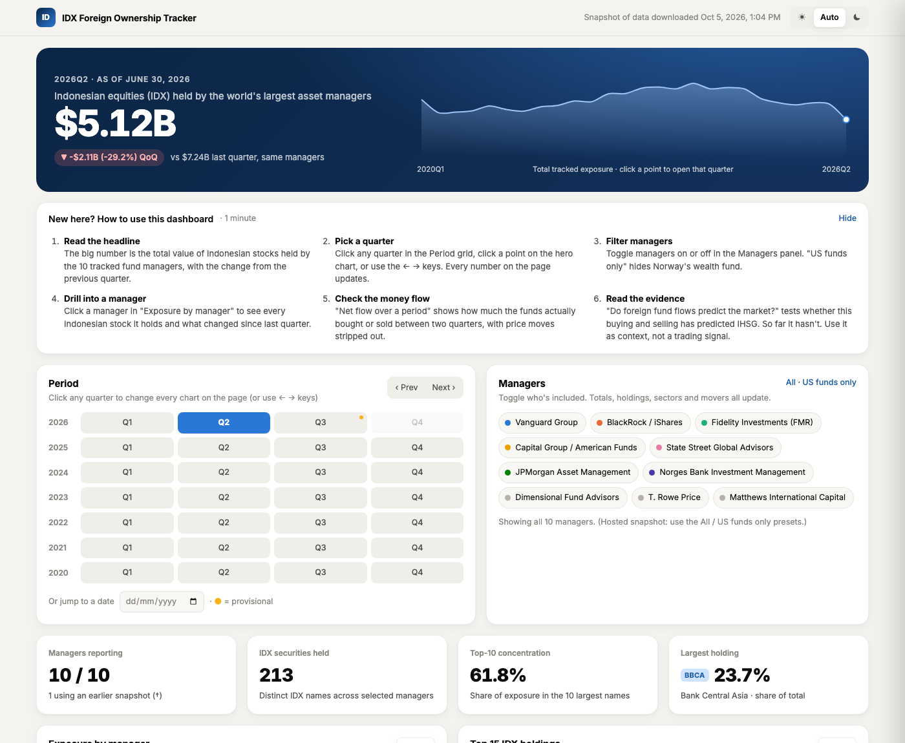
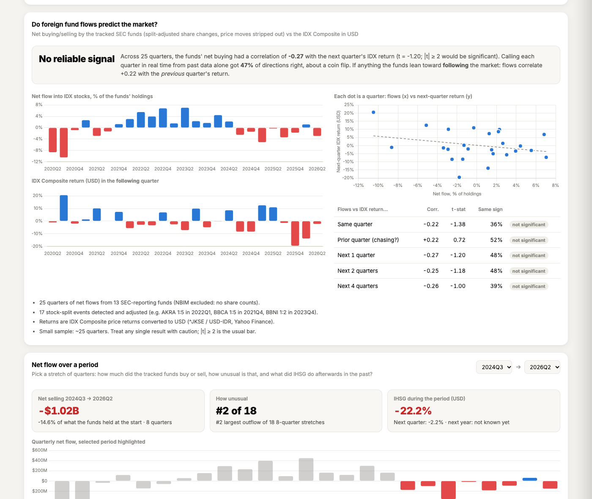

# IDX Foreign Ownership Tracker

Tracks how much Indonesian (IDX) stock the world's largest asset managers hold, every quarter since 2020, from public filings, and tests whether their buying and selling predicts the market (IHSG).


**Live dashboard:** https://izzanahsan.github.io/idx-foreign-ownership/



## What it shows

- **$5.12B tracked exposure** in the 2026Q2 snapshot across 10 asset managers and 14 fund portfolios.
- **Peak holdings reached $10.06B** in 2024Q1 before trending lower.
- **BBCA (Bank Central Asia) is held by all 10 managers.**
- **Heavy portfolio concentration:** the top-10 names represent 61.8% of total tracked exposure, with financials accounting for 46.1%.
- **$1.02B in net selling over the last 8 quarters** (2024Q3–2026Q2), shedding 14.6% of holdings—the second-heaviest selling stretch across 18 rolling eight-quarter periods, while the IHSG fell 22.2% in USD terms.

Each quarter also exports as a one-page infographic and a two-page PDF: [example (2026Q2)](assets/screenshots/infographic.png). Dark mode: [screenshot](assets/screenshots/dark.png).

## Does foreign money predict IHSG?

Net flows are calculated as split-adjusted share changes multiplied by price, which strips out valuation movements caused by price fluctuations. Across the 2020Q1 to 2026Q3 dataset, 17 stock splits were identified and adjusted (including BBCA's 1:5 split in 2021Q4 and DSSA's 1:25 split in 2026Q2).

| Comparison | Correlation | t-stat | Significant? |
| :--- | :--- | :--- | :--- |
| Same quarter | -0.22 | -1.38 | No |
| Prior quarter | +0.22 | +0.72 | No |
| Next 1 quarter | -0.27 | -1.20 | No |
| Next 2 quarters | -0.25 | -1.18 | No |
| Next 4 quarters | -0.26 | -1.00 | No |

### Reading the numbers

Correlation measures the co-movement between split-adjusted foreign net flows and IHSG USD returns across 25 quarters (2020Q2–2026Q2). For statistical significance, the bar is |t| >= 2; |t| >= 2 means a relationship that strong would appear by chance only about 5% of the time if there were no real relationship. None of the measured horizons meet this threshold. With 25 quarters of data, an observed correlation of -0.27 would require roughly 53 quarters (~13 years) to achieve statistical significance.

Out-of-sample directional accuracy was 47%, which is indistinguishable from a coin flip. The conclusion is that tracked foreign fund flows provide no reliable predictive signal for IHSG performance; if anything, fund flows lag and follow the market.



## Using the website

1. **Review headline metrics**: Inspect the top hero card showing total tracked value and sparkline, alongside high-level portfolio KPIs.
2. **Select a quarter or date**: Click any quarter on the Period grid, navigate with arrow keys, or jump to a specific date. Because SEC Form N-PORT filings are due within 60 days of quarter-end, quarters ending less than 75 days ago are marked as provisional; the dashboard defaults to the latest complete quarter.
3. **Filter asset managers**: Use filter chips to adjust fund exposure. The local application allows toggling each of the 10 managers individually, while the hosted static website provides toggles for "All" or "US funds only".
4. **Inspect individual managers**: Browse the ranked asset manager table and click any manager row to slide out a detailed positions drawer.
5. **Analyze portfolio composition**: View top-15 holdings and toggle the stacked asset distribution chart between total USD value and Share %.
6. **Examine historical flows**: Open the "Net flow over a period" explorer to track aggregate capital injections and redemptions across custom intervals.
7. **Evaluate market predictive power**: Review the "Do foreign fund flows predict the market?" section for quarterly correlation tables and directional hit rates against the IHSG.
8. **Compare periods**: Use the quarter comparison tool to review each manager's holdings side-by-side between two dates, including absolute and percentage shifts.
9. **Export and view guides**: Toggle between light, dark, and auto display themes, or expand the "How to use" guide. The local application includes a "Refresh data" button and exports custom PNG (300 dpi) and PDF reports, while the hosted website links directly to pre-generated PDF reports for each complete quarter.

## Run it yourself

```bash
git clone https://github.com/izzanahsan/idx-foreign-ownership.git && cd idx-foreign-ownership
python3 -m venv .venv
.venv/bin/pip install -r requirements.txt
echo 'SEC_USER_AGENT="Your Name you@example.com"' > .env.local
.venv/bin/python main.py ingest
.venv/bin/python main.py web
```

Run tests offline:
```bash
.venv/bin/python -m pytest -q
```
The test suite contains 26 automated offline tests. A GitHub Actions workflow runs them on every push.

### CLI commands

| Command | What it does |
| :--- | :--- |
| `python main.py` | Launches the interactive terminal dashboard. |
| `python main.py ingest` | Downloads SEC N-PORT filings and NBIM holdings data (~40 min on first run; Yahoo Finance index data is fetched on demand). |
| `python main.py dashboard` | Displays the terminal dashboard view directly. |
| `python main.py report` | Generates a one-page 300 dpi PNG infographic and two-page PDF report with data appendix (`--quarter`, `--date`, `--all`, `--theme dark`). |
| `python main.py status` | Shows data coverage per fund: first and last snapshot and snapshot count. |
| `python main.py export-parquet` | Exports the normalized holdings table to `data/processed/holdings.parquet`. |
| `python main.py demo` | Loads a synthetic 2020–2026 dataset into a separate database (no network) and opens the terminal dashboard. |
| `python main.py web` | Starts the web dashboard at `http://localhost:8050` and opens your browser. |

## Publish your own copy

1. Authenticate with GitHub CLI:
   ```bash
   gh auth login
   ```
2. Build the static site and deploy code and web assets:
   ```bash
   ./deploy.sh
   ```
   This generates the static build in `docs/` and publishes code and website via GitHub Pages.
3. To deploy only the static website without source code to a dedicated repository:
   ```bash
   ./deploy.sh --site-only
   ```
4. Re-run `./deploy.sh` after refreshing local data with `python main.py ingest`.

## Methodology

- **Filing sources**: Collects ~350 SEC Form N-PORT filings via EDGAR and annual/semi-annual holdings via the NBIM API, covering ~13,800 holding records from 2020Q1 to 2026Q3.
- **Coverage**: Covers 10 managers across 14 fund portfolios: Vanguard (VWO/VEIEX), BlackRock/iShares (EIDO, IEMG), Fidelity (FEMKX), Capital Group (NEWFX, AEPGX), State Street (SPEM), JPMorgan (JFAMX), Dimensional (DFCEX), T. Rowe Price (PRMSX, PRIJX), Matthews (MAPTX, MPACX), and NBIM's entire equity portfolio.
- **Calendar normalization**: Fund fiscal-quarter snapshots are snapped to standard calendar quarters. NBIM reported annually prior to 2024 and semi-annually thereafter; its holdings are carried forward up to 370 days and marked with a dagger (†).
- **Entity resolution**: NBIM filings do not provide ISINs. SEC and NBIM holdings are merged by resolving issuer names to IDX tickers, matching 99.6% of portfolio value.
- **Asset filtering**: Includes strictly Indonesian equity holdings (asset categories `EC` or `EP`, country code `ID`, or Indonesian `ID` ISIN). Cash, debt securities, and rights offerings are excluded; the TLKM ADR is retained.
- **Like-for-like QoQ calculation**: Quarter-over-quarter holding changes include only managers reporting in both consecutive periods.
- **Provisional filings window**: Form N-PORT filings are due within 60 days of quarter end. Any quarter concluded within the last 75 days is flagged as provisional while filings arrive.
- **Flow calculations**: Flow calculations strip out price movements by multiplying split-adjusted share balance changes by security price, adjusting for 17 corporate stock splits.

## Project layout

```
idx-foreign-ownership/
├── .github/
│   └── workflows/
│       └── tests.yml
├── analytics/
│   ├── flow_signal.py
│   └── tracker_engine.py
├── assets/
│   └── screenshots/
├── docs/
├── scrapers/
│   ├── market_data.py
│   ├── nbim_scraper.py
│   └── sec_edgar.py
├── tests/
│   └── test_mock_pipeline.py
├── visualization/
│   ├── chart_exporter.py
│   └── terminal_ui.py
├── web/
│   ├── static/
│   │   └── index.html
│   ├── build_static.py
│   └── server.py
├── config.py
├── deploy.sh
├── idx_securities.py
├── LICENSE
├── main.py
├── README.md
├── requirements.txt
└── storage.py
```

## How this was built

Built with Claude Code for coordination, architecture, data pipeline implementation, and verification, using the Gemini bridge for drafting. The first working prototype with live data was established in about an hour, followed by complete project construction within one day.

## Disclaimer

Tracked values represent holdings of the listed fund vehicles only, not each firm's total institutional asset exposure to Indonesia. This project is for informational and research purposes only and does not constitute investment advice.

## License

MIT, see LICENSE.
